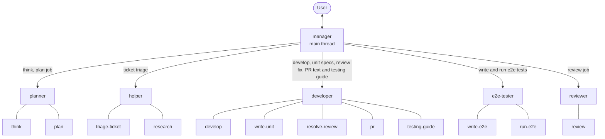
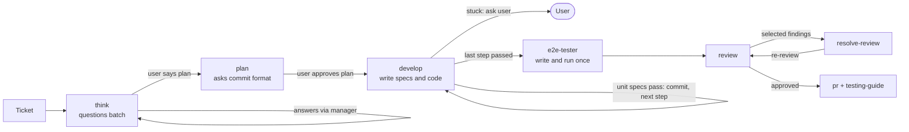
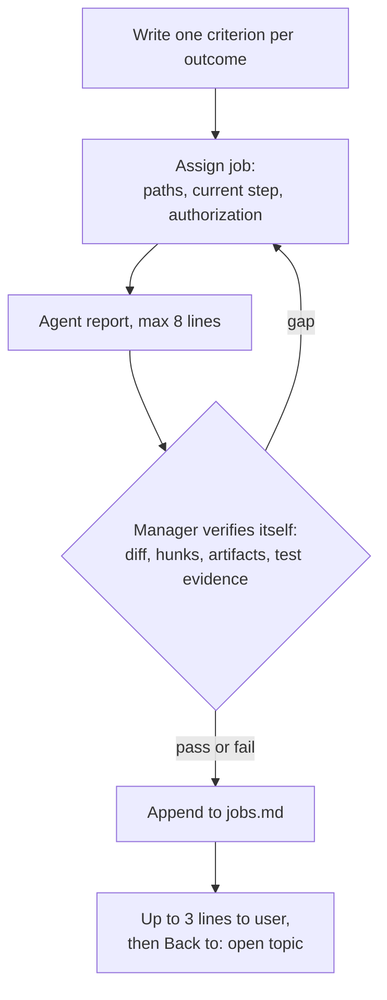

# Architecture

## Agents and skills

`manager` runs in the main thread. It assigns each job to one of five agents. Each agent holds several skills and does its job itself. Only agents carry role names; skills are named by action.

## Ticket flow

## Manager loop

## Planner questions

`planner` cannot talk to the user directly. It returns one numbered batch of at most seven questions from `think`, each with a recommended answer, or the commit-format question from `plan`. The manager shows the batch unchanged and sends the answers back to the same planner. Each round costs a little manager context; the planner's own context stays cached. Fewer rounds cost fewer tokens, so answer by number.

## Why this structure

- **Fewer agents, fewer re-reads.** Each new agent re-reads rules, plan, and diff. Earlier, one plan step started about four agents: developer, spec writer, and two runners. Now one `developer` writes the unit specs and code for a step and runs the specs itself, and `e2e-tester` writes and runs the e2e specs once, before review.
- **One developer per tier per ticket.** A plan step goes to the ticket's existing `developer` of the step's tier (standard by default, advanced for a complicated step), so a 12-step ticket starts at most two developers, not twelve. `checklist.md` carries progress between steps. Trade-off: a developer's context grows over the ticket. Within a ticket, agents stay alive and get later work by SendMessage to the same ID, so a re-test or re-review does not re-read the rules, plan, and diff. Finished agents cost nothing while idle. The manager records each ID in `jobs.md`; if an agent is gone, it starts a fresh one that reads the plan, `checklist.md`, and `jobs.md`.
- **Plan approval is the gate.** With per-step commits, approving the plan approves every step, its one-line commit message, and the file deletions it lists. `develop` implements and commits step after step without asking. It stops and asks only when a spec still fails after two fixes, a step needs something outside the plan, or the plan is unclear. It never loops on a failure.
- **The test author runs the test.** `developer` writes unit specs, because they drive the code. `e2e-tester` writes and runs the e2e specs, so QA owns QA tests. Testers run only the specs the task changed and report other specs that may be affected.
- **Plugin files live outside the repo.** Tasks, reviews, domain notes, the commit format, the PR text and the testing guide are all saved under `~/.agent-workflow/`, so any project can use them.
- **Reviewer reuse.** The same `reviewer` re-reviews the ticket and updates `review.md` in place. Trade-off: a re-review carries its earlier findings, so it is less independent than a fresh read.
- **Manager verifies, not trusts.** An agent's "done" is a claim. The manager checks the diff, artifacts, and test result itself before reporting.
- **Short reports.** Agents report in at most eight lines; the manager announces a job in one line and reports it in at most three. Detail lives in `state/jobs.md` in the task folder.
- **Model by agent and tier.** Skills are grouped by weight into light, standard and advanced. The manager passes `model` and `effort` on every start and may start a developer or reviewer at another tier for a complicated or simple job. See [agents.md](../../skills/manager/references/agents.md).
- **Claude Code first.** Agents work only in Claude Code. Skills stay plain `SKILL.md` files, so other hosts run them directly on the chat's own model, with no subagents.
