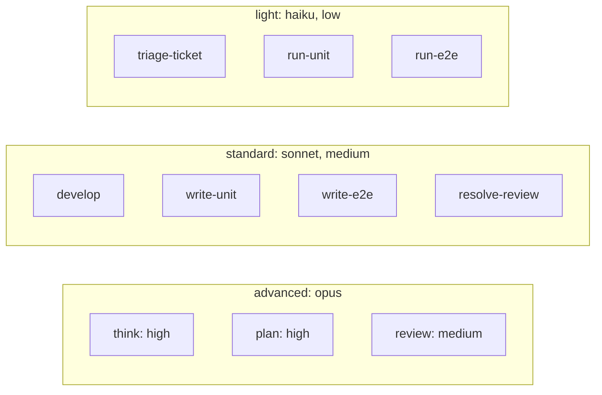

# Models and effort

Three tiers: light (haiku), standard (sonnet), advanced (opus). The manager passes `model` and `effort` on every agent start. Agent frontmatter sets neither, so an unset start would inherit the manager's model. A resumed agent keeps its model and effort, so a different tier means a separate agent start.

| Agent | Skills | Default tier | Claude Code | Effort | Manager may start |
| --- | --- | --- | --- | --- | --- |
| `planner` | `think`, `plan` | advanced | opus | high | |
| `helper` | `triage-ticket` | light | haiku | low | |
| `unit-tester` | `run-unit` | light | haiku | low | |
| `e2e-tester` | `run-e2e` | light | haiku | low | |
| `developer` | `develop`, `write-unit`, `write-e2e`, `resolve-review` | standard | sonnet | medium | advanced: opus, medium, for a complicated step |
| `reviewer` | `review` | advanced | opus | medium | standard: sonnet, medium, for a simple change; advanced: opus, high, when the user asks |

A ticket can hold one `developer` per tier, each reused across steps of its tier.

`developer` never runs tests. Every unit run goes to `unit-tester` and every e2e run to `e2e-tester`, and a failure goes back to `developer` for diagnosis and a fix.

Each skill's `metadata.tier` and `effort` match its agent's default.

Other hosts start no agents, so a skill runs on the chat's own model.

